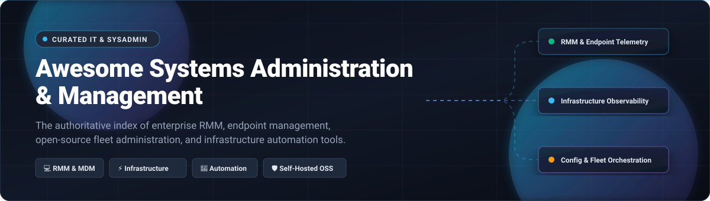

  

# 🛠️ Awesome Systems Administration & Management 🖥️

  
  
  
  
  
  

> 🌐 **A comprehensive, SEO-optimized curated directory of Systems Administration, Remote Monitoring & Management (RMM), Unified Endpoint Management (UEM), Infrastructure Observability, and Fleet Automation tools** — comparing enterprise commercial SaaS solutions and powerful self-hosted open-source software (OSS).
>
> 🌟 *Star this repository if you find it helpful for your IT architecture, DevOps stack, or SysAdmin toolkit!* 🌟

---

## 🧭 Table of Contents 📑

- [📈 Sector Overview & Market Dynamics](#-sector-overview--market-dynamics-)
- [🟦 SaaS & Hosted Enterprise Platforms](#-saas--hosted-enterprise-platforms-)
  - [🏢 Enterprise SaaS Comparison Table](#-enterprise-saas-comparison-table)
  - [🔍 Detailed SaaS Platform Summaries](#-detailed-saas-platform-summaries)
- [🟩 Open-Source Software (Ranked by Stars)](#-open-source-software-ranked-by-stars-)
  - [⭐ Top Open-Source Projects Overview](#-top-open-source-projects-overview)
  - [🔬 Detailed Open-Source Solution Profiles](#-detailed-open-source-solution-profiles)
- [📊 Architectural Comparison at a Glance](#-architectural-comparison-at-a-glance-)
- [🤝 Contributing Guidelines](#-contributing-guidelines-)
- [💖 Support & Sponsorship](#-support--sponsorship-)
- [📈 Star History](#-star-history-)
- [📄 License & Disclaimers](#-license--disclaimers-)

---

## 📈 Sector Overview & Market Dynamics 🌐

The global **Unified Endpoint Management (UEM) and Systems Administration software market** is valued at approximately **$14.5 Billion to $16.5 Billion**, projected to surpass **$35 Billion to $42 Billion by 2030** at a rapid Compound Annual Growth Rate (CAGR) of **18% to 22%** driven by hybrid distributed workforces, BYOD policies, Zero Trust cybersecurity enforcement, and AI-assisted IT operations (AIOps).

The sector exhibits **moderate fragmentation across specialized IT niches (RMM, multi-cloud observability, and configuration automation)**, but displays **high concentration and consolidation at the unified OS/endpoint governance tier**, where mega-cap ecosystem platforms (notably Microsoft) capture the lion's share of enterprise desktop deployments while specialized high-growth challengers compete aggressively for MSP and hybrid fleets.

---

## 🟦 SaaS & Hosted Enterprise Platforms ☁️

Enterprise-grade, cloud-hosted Systems Administration, IT Service Management, and Remote Monitoring platforms sorted descending by company scale (valuation / market capitalization).

### 🏢 Enterprise SaaS Comparison Table

| Product 🏷️ | Primary Category 🗂️ | Starting Tier Pricing 💵 | Free Tier Limit / Trial Duration ⏳ | Company Scale (Valuation / Revenue) 🏛️ | Deployment 🚀 |
| :--- | :--- | :--- | :--- | :--- | :--- |
| **[Microsoft Intune](https://www.microsoft.com/en-us/security/business/endpoint-management/microsoft-intune)** | Unified Endpoint Management (UEM) & MDM | **$8.00 / user / month** (Intune Plan 1 standalone; or $3.50/device/mo for shared devices) | **30-Day Free Trial** (up to 25 user licenses; 90-day trial for Intune Suite add-on) | **~$3.1 Trillion Market Cap** (Microsoft NASDAQ: MSFT) | Cloud SaaS |
| **[NinjaOne](https://www.ninjaone.com/)** | Unified IT Operations, Patching & RMM | **~$3.00 - $3.75 / device / month** (starts ~$1.50/dev/mo at scale; quote-based) | **14-Day Free Trial** (full unrestricted feature access, no credit card required) | **$12.3 Billion Valuation** (~$500M+ ARR) | Cloud SaaS |
| **[ManageEngine Endpoint Central](https://www.manageengine.com/products/desktop-central/)** | Unified Endpoint Management & Security | **$795 / year** for 50 endpoints (~$1.32 / endpoint / month on Cloud Pro) | **Free Forever Edition** (up to **25 endpoints** & 1 technician; 30-day unlimited trial) | **$1.0+ Billion Revenue** (Zoho Corporation bootstrap) | Cloud & On-Premises |
| **[SolarWinds Server & Application Monitor](https://www.solarwinds.com/server-application-monitor)** | Infrastructure & Server Monitoring (SAM) | **$2,900** starting base license (or ~$1,813/yr subscription) | **30-Day Free Trial** (fully functional, 1,200+ app templates, no CC required) | **~$3.2 Billion Market Cap** (~$780M+ TTM Revenue; NYSE: SWI) | Hybrid / Self-Hosted / SaaS |
| **[JumpCloud](https://jumpcloud.com/)** | Cloud Directory Platform & MDM | **$9.00 / user / month** (Device Management plan; billed annually) | **30-Day Free Trial** (unlimited users & devices; legacy 10-user free tier discontinued) | **$2.6 Billion Valuation** (~$416M+ VC funding) | Cloud SaaS |
| **[Jamf Pro](https://www.jamf.com/products/jamf-pro/)** | Apple Enterprise Management & MDM | **$12.50 / device / month** (Jamf for Mac, 25-device min; Jamf Now starts $4/dev/mo) | **14-Day Free Trial** (full enterprise macOS/iOS management, no CC required) | **~$1.7 Billion Market Cap** (NASDAQ: JAMF) | Cloud & On-Premises |
| **[Kaseya VSA](https://www.kaseya.com/products/vsa/)** | Enterprise MSP RMM & Endpoint Management | **~$3.99 / endpoint / month** (via Kaseya 365 bundle; ~$4-$6 standalone) | **14-Day Free Trial** (guided sandbox trial upon sales validation) | **~$1.5 Billion Revenue** (PE-backed Insight Partners; acquired Datto for $6.2B) | Cloud & On-Premises |
| **[Atera](https://www.atera.com/)** | All-in-One RMM & PSA for MSPs & IT | **$129 / technician / month** (MSP Pro annual; $149/tech/mo for IT Depts) | **30-Day Free Trial** (unlimited endpoints, full AI Copilot access, no CC required) | **$500 Million Valuation** ($102M funding; General Atlantic) | Cloud SaaS |

---

### 🔍 Detailed SaaS Platform Summaries

#### 1. 🪟 Microsoft Intune
- **Architecture & Ecosystem:** Cloud-native endpoint governance and MAM/MDM backbone deeply unified with Microsoft Entra ID (Azure AD), Defender for Endpoint, and Microsoft 365 E3/E5 licensing.
- **Key Capabilities:** Zero-touch Windows Autopilot, Apple Automated Device Enrollment (ADE), Android Enterprise work profiles, Linux desktop compliance policies, conditional access enforcement, and automated endpoint privilege management.
- **Ideal For:** Medium-to-large global enterprises centered on the Microsoft 365 ecosystem requiring compliance auditing and conditional access security.

#### 2. 🥷 NinjaOne
- **Architecture & Ecosystem:** Modern, cloud-first remote monitoring and management (RMM) platform built for ultra-fast agent execution, zero on-premises infrastructure requirements, and multi-tenant MSP architectures.
- **Key Capabilities:** Fast cross-platform OS & third-party patch management (Windows, Mac, Linux), automated remediation scripts, built-in cloud backup, remote terminal control, and mobile device management without per-technician pricing penalties.
- **Ideal For:** MSPs and enterprise IT departments requiring reliable remote management with snappy user interfaces.

#### 3. 🏢 ManageEngine Endpoint Central
- **Architecture & Ecosystem:** Comprehensive unified endpoint management (UEM) suite delivered via cloud SaaS or standalone self-hosted on-premises server, avoiding proprietary hyperscaler vendor lock-in.
- **Key Capabilities:** Automated patching for 1,000+ Windows/macOS/Linux and third-party apps, OS imaging, software deployment, remote desktop troubleshooting, USB device peripheral restrictions, and IT asset inventory tracking.
- **Ideal For:** IT organizations wanting comprehensive unified endpoint control and a generous **free forever tier for up to 25 devices**.

#### 4. ☀️ SolarWinds Server & Application Monitor (SAM)
- **Architecture & Ecosystem:** Industry-standard infrastructure and server performance monitoring suite supporting hybrid enterprise datacenters, multi-cloud workloads, and on-premises virtualization.
- **Key Capabilities:** Agentless and agent-based telemetry across 1,200+ vendor templates, dependency mapping (AppStack/PerfStack), active hardware health sensors, and synthetic transaction tracking.
- **Ideal For:** Established enterprise operations centers (NOCs) managing complex heterogeneous physical hardware, VMware/Hyper-V virtualization, and legacy server footprints.

#### 5. ☁️ JumpCloud
- **Architecture & Ecosystem:** Cloud directory and open identity platform that unifies zero-trust directory services, SAML/OIDC Single Sign-On (SSO), RADIUS, and cross-platform device management.
- **Key Capabilities:** GPO-style policy enforcement across macOS, Windows, and Linux machines, passwordless biometric device MFA, remote screen assistance, and centralized user provisioning.
- **Ideal For:** Modern cloud-native companies seeking an agile alternative to on-premises Microsoft Active Directory.

#### 6. 🍎 Jamf Pro
- **Architecture & Ecosystem:** The gold standard for Apple fleet ecosystem administration (macOS, iOS, iPadOS, tvOS, visionOS), leveraging native Apple MDM protocols and declarative device management.
- **Key Capabilities:** Apple Business Manager (ABM) zero-touch enrollment, smart group policy deployment, Jamf App Catalog self-service curation, Mac identity provisioning via Jamf Connect, and endpoint threat defense.
- **Ideal For:** Mac-heavy engineering teams, creative agencies, and educational institutions committed to premier Apple-centric environments.

#### 7. 🛡️ Kaseya VSA
- **Architecture & Ecosystem:** High-scale, automation-driven RMM and endpoint management engine engineered primarily for Managed Service Providers (MSPs) and large internal corporate operations.
- **Key Capabilities:** Policy-driven patch automation, remote endpoint control, advanced ticketing automation, anti-ransomware rollback integrations, and multi-tenant infrastructure topology.
- **Ideal For:** Mature IT managed service providers seeking deeply integrated billing, ticketing, and automation pipelines.

#### 8. ⚡ Atera
- **Architecture & Ecosystem:** Cloud-native platform pairing remote monitoring and management (RMM) with Professional Services Automation (PSA) and native OpenAI-powered Copilot assistance.
- **Key Capabilities:** Flat-rate unlimited endpoint onboarding per technician, automated script generation via AI, live network discovery, ticketing, and real-time system performance alerts.
- **Ideal For:** Fast-growing IT providers and agile internal helpdesks that prioritize predictable staff-based pricing over per-node billing.

---

## 🟩 Open-Source Software (Ranked by Stars) 💻

Self-hosted, transparent, and auditable open-source infrastructure tools for endpoint management, fleet administration, configuration automation, and system observability. Sorted strictly in descending order of GitHub community stars.

### ⭐ Top Open-Source Projects Overview

| Rank 🏆 | Open-Source Project 📦 | GitHub_Stars ⭐ | Primary Focus 🎯 | Architecture / Tech Stack ⚙️ | License 📜 |
| :---: | :--- | :--- | :--- | :--- | :--- |
| **#1** | **[RustDesk](https://github.com/rustdesk/rustdesk)** |  | Self-Hosted Remote Desktop & Remote Support Control | Rust / Flutter / C++ | AGPL-3.0 |
| **#2** | **[Uptime Kuma](https://github.com/louislam/uptime-kuma)** |  | Self-Hosted Uptime & Service Health Monitoring | Node.js / Vue.js / SQLite | MIT |
| **#3** | **[Netdata](https://github.com/netdata/netdata)** |  | Real-Time High-Resolution System Performance Telemetry | C / Go / Python | GPL-3.0 |
| **#4** | **[Ansible](https://github.com/ansible/ansible)** |  | Agentless IT Automation & Configuration Management | Python / YAML / Jinja2 | GPL-3.0 |
| **#5** | **[Glances](https://github.com/nicolargo/glances)** |  | Cross-Platform Curses & Web Infrastructure Monitor | Python / Psutil | LGPL-3.0 |
| **#6** | **[NetBox](https://github.com/netbox-community/netbox)** |  | Infrastructure Source of Truth & IPAM/DCIM Management | Python / Django / PostgreSQL | Apache-2.0 |
| **#7** | **[Salt](https://github.com/saltstack/salt)** |  | High-Speed Event-Driven Remote Execution & Orchestration | Python / ZeroMQ / YAML | Apache-2.0 |
| **#8** | **[Cockpit](https://github.com/cockpit-project/cockpit)** |  | Web-Based Graphical Server Administration Console | C / JavaScript / Systemd | LGPL-2.1 |
| **#9** | **[Snipe-IT](https://github.com/snipe/snipe-it)** |  | IT Asset Management (ITAM), Hardware & License Tracker | PHP / Laravel / MySQL | AGPL-3.0 |
| **#10** | **[Semaphore](https://github.com/semaphoreui/semaphore)** |  | Modern Open-Source Web UI for Ansible, Terraform & Shell | Go / Vue.js / MySQL | MIT |
| **#11** | **[Checkmate](https://github.com/bluewave-labs/Checkmate)** |  | Modern Infrastructure, Server & Container Health Monitor | Node.js / React / Docker | Open Source |
| **#12** | **[MeshCentral](https://github.com/Ylianst/MeshCentral)** |  | Multi-Platform Remote Device Management & Web RDP/VNC | Node.js / WebSockets | Apache-2.0 |
| **#13** | **[Fleet](https://github.com/fleetdm/fleet)** |  | API-First Osquery Fleet Governance & Cross-Platform MDM | Go / osquery / MySQL | MIT (Core) |
| **#14** | **[GLPI](https://github.com/glpi-project/glpi)** |  | Enterprise ITIL Service Desk, Asset & Endpoint Inventory | PHP / Symfony / MariaDB | GPL-3.0 |
| **#15** | **[Zabbix](https://github.com/zabbix/zabbix)** |  | Enterprise Multi-Protocol Distributed Monitoring Solution | C / PHP / PostgreSQL | GPL-2.0 |
| **#16** | **[Tactical RMM](https://github.com/amidaware/tacticalrmm)** |  | Self-Hosted Open-Source Remote Management (RMM) | Python / Django / Go | Open Source |
| **#17** | **[MicroMDM](https://github.com/micromdm/micromdm)** |  | Minimalist Open-Source Apple MDM Protocol Server | Go / SQLite / Apple MDM | MIT |
| **#18** | **[NanoMDM](https://github.com/micromdm/nanomdm)** |  | Ultra-Lightweight Pluggable Apple MDM Server Backend | Go / MySQL / PostgreSQL | MIT |
| **#19** | **[NetLock RMM](https://github.com/0x101-Cyber-Security/NetLock-RMM)** |  | Modern Open-Core RMM with Code-Signed Installers | C# / ASP.NET / Blazor | Open Core (25 free) |
| **#20** | **[Glouton](https://github.com/bleemeo/glouton)** |  | Lightweight Host Monitoring Agent with Local TSDB & UI | Go / Prometheus TSDB | Open Source |
| **#21** | **[MDMesh](https://github.com/MDMesh-app/MDMesh)** |  | Self-Hosted Android Mobile Device Management & Kiosk | Java / React / Kotlin | Open Source |
| **#22** | **[OpenRMM](https://github.com/openrmm-project/openrmm)** |  | AI-Driven RMM with Model Context Protocol (MCP) Server | Go / React / PostgreSQL | Open Source |

---

### 🔬 Detailed Open-Source Solution Profiles

#### 1. 🦀 [RustDesk](https://github.com/rustdesk/rustdesk)
- **Stack & Architecture:** Built with Rust, Flutter, and C++ for ultra-low latency remote desktop streaming.
- **Why It Matters:** Serves as the premier self-hosted open-source alternative to TeamViewer and AnyDesk with complete end-to-end encryption (E2EE), zero third-party relays required, and cross-platform native binaries.

#### 2. 🦝 [Uptime Kuma](https://github.com/louislam/uptime-kuma)
- **Stack & Architecture:** Node.js, Vue.js, and SQLite packaged into a single lightweight Docker container.
- **Why It Matters:** A sleek, reactive self-hosted monitoring tool tracking HTTP(s), TCP, Ping, DNS, and Docker containers with incident notifications across 90+ webhook channels and customizable status pages.

#### 3. 📊 [Netdata](https://github.com/netdata/netdata)
- **Stack & Architecture:** Highly optimized C daemon collecting per-second system metrics with negligible CPU (<1%) and memory footprint.
- **Why It Matters:** Out-of-the-box infrastructure monitoring with zero configuration, auto-discovering containers, systemd units, network interfaces, and kernel metrics in real-time.

#### 4. 📜 [Ansible](https://github.com/ansible/ansible)
- **Stack & Architecture:** Python and human-readable YAML executed agentlessly over standard SSH and WinRM protocols.
- **Why It Matters:** The world's most adopted configuration management and server provisioning platform, eliminating client agent maintenance on managed endpoints.

#### 5. 👁️ [Glances](https://github.com/nicolargo/glances)
- **Stack & Architecture:** Python engine utilizing `psutil` libraries with both terminal curses and web-based UI views.
- **Why It Matters:** An indispensable tool for systems administrators needing an instant, comprehensive view of CPU, memory, disks, I/O rates, network bandwidth, and Docker containers on any remote box.

#### 6. 🗄️ [NetBox](https://github.com/netbox-community/netbox)
- **Stack & Architecture:** Python, Django, PostgreSQL, and Redis.
- **Why It Matters:** The de facto open-source infrastructure "source of truth" (SoT) combining IP address management (IPAM), datacenter inventory (DCIM), rack layouts, and cable telemetry.

#### 7. ⚡ [Salt (SaltStack)](https://github.com/saltstack/salt)
- **Stack & Architecture:** High-speed event-driven orchestration engine using ZeroMQ message buses and Python.
- **Why It Matters:** Capable of issuing remote commands and enforcing configuration states across tens of thousands of minion nodes within seconds.

#### 8. 🎛️ [Cockpit](https://github.com/cockpit-project/cockpit)
- **Stack & Architecture:** C backend directly speaking to Linux system APIs (D-Bus, systemd) with a responsive web dashboard.
- **Why It Matters:** Makes Linux server management accessible from any web browser — allowing admins to control storage, review SELinux logs, update packages, and launch containers without command-line overhead.

#### 9. 🏷️ [Snipe-IT](https://github.com/snipe/snipe-it)
- **Stack & Architecture:** PHP, Laravel framework, MySQL/MariaDB database.
- **Why It Matters:** Industry-standard open-source IT asset tracking system managing hardware lifecycles, user assignments, software licenses, warranties, and consumable inventory.

#### 10. 🚦 [Semaphore](https://github.com/semaphoreui/semaphore)
- **Stack & Architecture:** Go single-binary backend with a responsive Vue.js frontend and MySQL/Postgres/BoltDB storage.
- **Why It Matters:** A sleek, lightweight open-source alternative to Ansible Tower / AWX, providing a web UI for running Ansible playbooks, Terraform scripts, and custom shell jobs with role-based access.

#### 11. 🎯 [Checkmate](https://github.com/bluewave-labs/Checkmate)
- **Stack & Architecture:** Node.js, React, and Docker-oriented architecture paired with a lightweight companion capture agent.
- **Why It Matters:** Real-time uptime and server resource dashboard monitoring remote server disks, temperatures, S.M.A.R.T. health, and container states with zero telemetry leak.

#### 12. 🕸️ [MeshCentral](https://github.com/Ylianst/MeshCentral)
- **Stack & Architecture:** Node.js server with multi-platform background agents and HTML5 browser-based remote control.
- **Why It Matters:** Full-featured web-based computer management server supporting remote desktop (VNC/RDP), remote terminal shell, file transfer, and Intel AMT out-of-band management.

#### 13. 🛡️ [Fleet](https://github.com/fleetdm/fleet)
- **Stack & Architecture:** Go server backed by osquery and nanoMDM for API-driven fleet visibility.
- **Why It Matters:** Brings GitOps-style device management to thousands of macOS, Windows, Linux, and ChromeOS devices using SQL queries against operating system state.

#### 14. 🎫 [GLPI](https://github.com/glpi-project/glpi)
- **Stack & Architecture:** PHP, Symfony, and MariaDB.
- **Why It Matters:** Robust ITIL-compliant service desk and automated IT asset discovery platform connecting helpdesk ticketing with physical and virtual asset inventories.

#### 15. 📈 [Zabbix](https://github.com/zabbix/zabbix)
- **Stack & Architecture:** High-performance C core, PHP web frontend, and relational database backend.
- **Why It Matters:** Enterprise-grade distributed monitoring supporting SNMP, IPMI, JMX, active/passive agents, and Zabbix Proxies for managing massive physical and virtual environments.

#### 16. 🛠️ [Tactical RMM](https://github.com/amidaware/tacticalrmm)
- **Stack & Architecture:** Python, Django, Go agent, and MeshCentral integration.
- **Why It Matters:** Provides an active self-hosted RMM console with Windows/Linux agent management, remote powershell execution, automated patch policies, and alert routing.

#### 17. 🍏 [MicroMDM](https://github.com/micromdm/micromdm)
- **Stack & Architecture:** Go server implementation implementing Apple's Mobile Device Management (MDM) protocol specifications.
- **Why It Matters:** Enables custom Apple device deployment workflows and Apple Business Manager integrations without proprietary vendor lock-in.

#### 18. ⚡ [NanoMDM](https://github.com/micromdm/nanomdm)
- **Stack & Architecture:** Go micro-service architecture supporting pluggable storage backends (SQLite, MySQL, PostgreSQL).
- **Why It Matters:** A modular, ultra-lightweight Apple MDM server backend built to handle high-throughput MDM check-ins and command dispatches.

#### 19. 🔒 [NetLock RMM](https://github.com/0x101-Cyber-Security/NetLock-RMM)
- **Stack & Architecture:** C#, ASP.NET Core, Blazor web UI, and MySQL.
- **Why It Matters:** German-engineered open-core RMM offering 53 pre-built report templates, visual query builders, and code-signed Windows agents with a 25-device community tier.

#### 20. 🐾 [Glouton](https://github.com/bleemeo/glouton)
- **Stack & Architecture:** Go single-binary daemon with an embedded Prometheus-compatible TSDB and local dashboard on port 8015.
- **Why It Matters:** Extremely light (~100 MB RAM) monitoring agent auto-discovering Docker, Kubernetes, SNMP, SMART, and NVIDIA GPU metrics without requiring complex server infrastructure.

#### 21. 📱 [MDMesh](https://github.com/MDMesh-app/MDMesh)
- **Stack & Architecture:** Java control plane, React web UI, Kotlin Android agent, and PostgreSQL.
- **Why It Matters:** Complete open-source Android MDM with QR-code Device-Owner provisioning, dedicated kiosk/COSU locked-down modes, silent APK distribution, and remote wipe capabilities.

#### 22. 🤖 [OpenRMM](https://github.com/openrmm-project/openrmm)
- **Stack & Architecture:** Go endpoint agent, React console, PostgreSQL, and integrated Model Context Protocol (MCP) server.
- **Why It Matters:** Next-generation RMM platform featuring native AI agent assistance through Claude/ChatGPT with mandatory human-in-the-loop authorization gates for fleet modifications.

---

## 📊 Architectural Comparison at a Glance ⚖️

| Solution 🧰 | License Model 📜 | Endpoint MDM 📱 | Remote Shell / Desktop 🖥️ | Performance Telemetry 📈 | Self-Hosted 🏠 | Target Audience 🎯 |
| :--- | :--- | :---: | :---: | :---: | :---: | :--- |
| **Microsoft Intune** | Commercial SaaS | ✅ Yes | ⚠️ (Via Remote Help) | ⚠️ (Telemetry via Azure) | ❌ Cloud Only | Microsoft 365 Enterprise Fleets |
| **NinjaOne** | Commercial SaaS | ✅ Yes | ✅ Yes (Built-in) | ✅ Yes | ❌ Cloud Only | MSPs & Agile Enterprise IT Teams |
| **ManageEngine Endpoint Central** | Commercial / Free (25 dev) | ✅ Yes | ✅ Yes (Advanced) | ✅ Yes | ✅ Yes (Cloud/On-Prem) | Mid-Market & Hybrid IT Deployments |
| **RustDesk** | Open Source (AGPL-3.0) | ❌ No | ✅ Yes (Ultra-Low Latency) | ❌ No | ✅ Yes (Self-Hosted) | Secure Remote Support & IT Helpdesks |
| **Ansible** | Open Source (GPL-3.0) | ❌ No | ✅ Yes (SSH Execution) | ❌ No | ✅ Yes (Agentless) | DevOps & Infrastructure Automation |
| **NetBox** | Open Source (Apache-2.0) | ❌ No | ❌ No | ❌ No | ✅ Yes (Self-Hosted) | Network Engineers & Datacenter Admins |
| **Fleet** | Open Source (MIT Core) | ✅ Yes | ✅ Yes (via osquery) | ✅ Yes (SQL Query) | ✅ Yes (Self-Hosted) | Security Teams & GitOps Fleet Admins |
| **Zabbix** | Open Source (GPL-2.0) | ❌ No | ❌ No | ✅ Yes (Deep SNMP/Agent) | ✅ Yes (Self-Hosted) | Enterprise NOCs & Hardware Monitoring |
| **Snipe-IT** | Open Source (AGPL-3.0) | ❌ No | ❌ No | ❌ No | ✅ Yes (Self-Hosted) | IT Asset & License Inventory Managers |
| **Tactical RMM** | Open Source | ✅ Yes | ✅ Yes (MeshCentral) | ✅ Yes | ✅ Yes (Self-Hosted) | Self-Hosted Windows-Centric MSPs |
| **Uptime Kuma** | Open Source (MIT) | ❌ No | ❌ No | ✅ Yes (Uptime & Health) | ✅ Yes (Docker) | Homelabs & DevOps Service Monitors |
| **OpenRMM** | Open Source | ✅ Yes | ✅ Yes | ✅ Yes | ✅ Yes (Docker) | AI-Assisted System Administrators |

---

## 🤝 Contributing Guidelines 💡

We welcome active contributions from systems administrators, DevOps engineers, site reliability engineers (SREs), and open-source software maintainers!

If you want to suggest a new tool, please ensure it meets the following criteria:
1. **Actively Maintained:** Has verifiable commits and releases within the preceding 12 months.
2. **Clear Licensing:** Software must explicitly define its licensing terms (MIT, Apache-2.0, GPL, AGPL, or clear commercial pricing).
3. **Quality & Utility:** Projects should solve distinct systems administration, monitoring, endpoint management, or infrastructure automation challenges.

To contribute:
- Fork the repository.
- Create a new descriptive branch (`git checkout -b add-tool-name`).
- Add the tool to the appropriate section preserving alphabetical or star-ranked ordering.
- Submit a pull request with a clear description of the project and why it adds value.

---

## 💖 Support & Sponsorship ☕

Thank you so much for exploring and using **Awesome Systems Administration & Management**! 

If this curated repository saved you time, introduced you to great tools, or assisted in your infrastructure architecture, please consider supporting this project:

- ⭐ **Star this repository** on GitHub to increase its visibility for the broader community.
- 🍴 **Fork and contribute** by adding new tools, updating pricing tiers, or suggesting improvements.
- 📢 **Share this list** with fellow sysadmins, DevOps engineers, colleagues, and communities!
- ☕ **Sponsor the maintainer / Buy a coffee:** You can support continuous maintenance, research, and curation through the **[GitHub Sponsors Dashboard](https://github.com/sponsors/ishandutta2007)**.

---

## 📈 Star History

---

## 📄 License & Disclaimers ⚖️

This curated compilation is released under the **[Creative Commons Zero v1.0 Universal](https://creativecommons.org/publicdomain/zero/1.0/)** (Public Domain Dedication). You may copy, modify, distribute, and perform the work, even for commercial purposes, without asking permission.

All software products, logos, and trademarks mentioned belong to their respective corporate owners.

---

  <b>⭐ Found this curated list valuable? Star the repository to support ongoing maintenance! ⭐</b>

